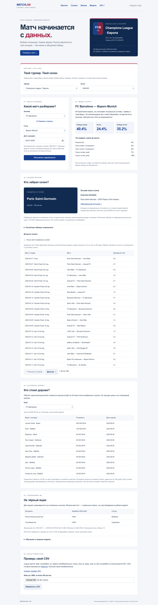

# MatchLab · European Football — v0.8

Учебный ML-сервис: пять европейских чемпионатов и три еврокубка. Вероятности победы хозяев, ничьей и победы гостей; история встреч, победители сезонов, награды и исторические оценки игроков. Barcelona остаётся стартовым клубом интерфейса (ID 131).

Футбольная адаптация лабораторной №10 вместо ипотеки; изменение предметной области требует согласования с преподавателем. **Рабочий MVP, не live-сервис и не инструмент для ставок.**

## Расширение v0.8

- La Liga, Premier League, Ligue 1, Bundesliga, Serie A.
- Champions League, Europa League, Conference League; команды разных стран в одном турнире.
- Выбор турнира и сезона: меняются участники, встречи, победитель, награды и оценки игроков.
- **28 188 матчей** за 2012/13–2024/25. Conference League доступна с 2021/22.
- История встреч с пагинацией и фильтром клуба. Указывается архивный счёт, а не обязательно счёт за 90 минут.
- Победители по архиву; расчётная таблица чемпионата.
- Лучшие игроки — **победители конкретных официальных наград**, со ссылками на источники. Для 2024/25 заполнены все восемь турниров. Прошлые сезоны заполнены частично; отсутствие записи явно показано. Не подменяем награды рыночной стоимостью.
- До 10 самых дорогих игроков клуба на **30 июня после сезона**, по последней доступной оценке не старше 365 дней. У каждого значения есть дата. Это оценочная стоимость, не цена трансфера.
- Новое обучение, метрики по каждому турниру, **47 автоматических тестов / 92% покрытия app+ml**. Проверены desktop и ширина 390 px, все селекторы, CL Barcelona–Bayern, исторический Messi.



## Данные: что входит в модель

| Турнир | В архиве | В ML-наборе |
|---|---:|---:|
| ES1 | 4,940 | 4,940 |
| GB1 | 4,940 | 4,940 |
| FR1 | 4,691 | 4,691 |
| L1 | 3,978 | 3,978 |
| IT1 | 4,940 | 4,940 |
| CL | 1,683 | 1,296 |
| EL | 2,440 | 1,721 |
| UCOL | 576 | 396 |

**26 902 матча** для ML: чемпионаты и европейские групповые этапы / league phase. Кубковый плей-офф исключён и из обучения, и из расчёта формы: архив может прибавлять пенальти к голам. Например, финал CL 2016 хранится как 6:4, а EL 2021 — 12:11. Эти значения не выдаются за счёт за 90 минут. Не удаляем настоящие крупные счета чемпионатов как выбросы.

Прогнозы еврокубков — оценка исхода игры по модели группового этапа, **не вероятность прохода, победы в двухматчевой серии или завоевания кубка**. Финалы на нейтральном поле отдельно не моделируются. История внутреннего чемпионата для клубов вне пяти лиг неполна; качество их признаков ниже. Рейтинг Elo таких клубов основан преимущественно на европейских играх.

Датасет и история не обновляются из интернета. Последний матч архива: **2025-05-31**. Выбор сезона не загружает текущие результаты.

## Запуск / обновление Windows

Docker Desktop должен работать. Для обновления заменить исходные файлы в прежней папке `barca-matchlab`, сохранить `.env`; не переносить старые исходники поверх новых. Старая модель v0.7 отклоняется как несовместимая и требует нового обучения. Том с ключом сохраняется.

```powershell
# Только при отсутствии .env; существующий токен не заменяется
if (-not (Test-Path .env)) { ("ADMIN_TOKEN=" + [guid]::NewGuid().ToString("N")) | Set-Content -Encoding ascii .env }
docker compose up --build -d
docker compose exec app python -m ml.train
docker compose restart app
docker compose ps
```

Сайт: **http://127.0.0.1:8001/**. Swagger: **http://127.0.0.1:8001/docs**. Обновить страницу с Ctrl+F5.

До обучения прогнозы дают 503, но справочники работают. Подписанный pipeline и локальный ключ находятся в Docker-томе `models`. Артефакты и ключи **не включены** в ZIP/Git: обучение создаёт их на компьютере пользователя. `docker compose down` сохраняет том, `down -v` удаляет модель и ключ. При переносе папки с другим именем Compose может создать другой том.

```powershell
docker compose logs --tail 50 app
docker compose down
```

Альтернатива без Docker: Python 3.12+, `pip install -r requirements-dev.txt`, `python -m ml.train`, `python -m uvicorn app.main:app --port 8001`. Для админ-методов задать ADMIN_TOKEN в окружении. Пакеты верхнего уровня закреплены; полный транзитивный lock пока не подготовлен.

## Проверить вручную

1. La Liga → 2024/25: Barcelona — Real Madrid, расчёт трёх вероятностей.
2. Champions League → 2024/25: Barcelona — Bayern Munich, другой турнир и межлиговая пара.
3. История CL: финал PSG — Inter, архивный счёт 5:0; победитель PSG, награда Dembélé.
4. Раздел стоимости, Barcelona → сезон 2018/19: Messi, €150 млн, оценка от 2019-06-11, срез 2019-06-30.
5. Barcelona → 2022/23: Messi не должен появляться как игрок Barcelona.
6. Поменять турнир на Premier League, Bundesliga, Serie A, Ligue 1; проверить состав участников и победителя 2024/25.

## API

| Метод | URL | Назначение |
|---|---|---|
| GET | `/competitions` | Турниры и сезоны |
| GET | `/teams?competition_id=CL&season=2024` | Участники турнира в выбранном сезоне |
| GET | `/season-summary?competition_id=CL&season=2024` | Победитель, расчётная таблица, награды/источники |
| GET | `/matches?competition_id=CL&season=2024&limit=20&offset=0` | Встречи; необязательный club_id |
| GET | `/players/valuable?club_id=131&season=2018` | Исторический топ стоимости на конец сезона |
| POST | `/predict` | Один/несколько матчей или готовые признаки, до 100 строк |
| POST | `/predict-from-csv` | Сырой/обработанный CSV, до 500 строк и 2 MiB |
| GET | `/features`, `/metrics`, `/health` | Схема, качество, состояние |
| POST | `/train`, `/upload-model` | Обучение / подписанная модель, X-Admin-Token |
| GET | `/model` | Скачать подписанную модель, X-Admin-Token |
| GET | `/example-csv` | Образец сырого CSV |

```json
{"matches":[{"competition_id":"CL","season":2024,"home_club_id":131,"away_club_id":27,"date":"2025-05-26"}]}
```

Обе команды должны быть участниками выбранного турнира/сезона; дата должна относиться к сезону (июль–июнь). Без competition_id используется ES1; season можно опустить, он выводится из даты. Сценарий на будущую дату не добавляет новых матчей. Для прошлого до даты обучения возвращается предупреждение `in_training_period`.

`features`: 13 числовых показателей + восемь индикаторов турнира = 21 колонка. Отбираются 10 числовых показателей; индикаторы турнира сохраняются, итого 18 входов estimator. Готовые признаки должны соответствовать `/features`; клиент отвечает за их расчёт без утечек. `matches` и `features` одновременно не принимаются.

CSV: `date,competition_id,season,home_club_id,away_club_id` или готовые признаки. Поля competition_id/season необязательны. `result` — home/draw/away, необязательно. ROC-AUC рассчитывается по вероятностям, только при наличии всех трёх классов; иначе null с объяснением. Исходные колонки сохраняются. Оценка произвольного CSV не объявляется независимым тестом.

Ошибки: 401 токен; 404 отсутствующий турнир/сезон/клуб; 413 размер файла; 422 валидация; 503 нет модели / управление не настроено. `X-Process-Time` включён.

## Обучение и измеренное качество

Train 2012–2020: **18486** матчей; validation 2021–2022: **4228**; test 2023–2024: **4188**. Последовательное разбиение вместо перемешивания по времени. Победитель выбирается только на validation, затем переобучается на train+validation; test не участвует в выборе алгоритма.

Признаки: Elo, средние очки/забитые/пропущенные за пять предшествующих игр, отдых, число игр, фиксированное one-hot кодирование турнира. Все игры одного дня получают признаки **до обновления этого дня**. Текущие голы, итоговые места, награды и стоимость игроков не входят в ML-признаки. Imputer / SelectKBest / scaler обучаются внутри pipeline. На тесте допускается использовать уже завершённые предыдущие тестовые матчи (walk-forward), но не будущие результаты.

В раннем train нет Conference League, начавшейся в 2021: при выборе алгоритма происходит перенос между турнирами; финальное переобучение использует 2021/22–2022/23. Это ограничение явно сохраняется, а не скрывается под общим ROC-AUC.

| Модель | Validation ROC-AUC macro OVR | Accuracy |
|---|---:|---:|
| logistic_regression | 0.6643 | 0.5338 |
| random_forest | 0.6585 | 0.5355 |

Выбрана **logistic_regression**. На финальном тесте: **ROC-AUC 0.6688**, accuracy **53.9%**, log loss **0.9720**. DummyClassifier(prior) ROC-AUC: 0.5000. ROC-AUC не является процентом угаданных матчей или доказательством точной калибровки.

| Турнир — отдельный test | ROC-AUC | Accuracy |
|---|---:|---:|
| CL | 0.7197 | 0.6333 |
| EL | 0.6542 | 0.5583 |
| ES1 | 0.6835 | 0.5355 |
| FR1 | 0.6287 | 0.5163 |
| GB1 | 0.6669 | 0.5553 |
| IT1 | 0.6800 | 0.5276 |
| L1 | 0.6614 | 0.5180 |
| UCOL | 0.6374 | 0.5294 |

Еврокубковые строки таблицы относятся **только к групповым этапам**, не к плей-офф. Метрики v0.7 и v0.8 нельзя напрямую сравнивать как улучшение: состав тестового набора изменился. Нет гарантии результата, нет травм, составов, live-коэффициентов и автоматического обновления данных.

## Исторические игроки и победители: методика

- Один срез на сезон — 30 июня следующего года, а не произвольная пользовательская дата. Это состав по доступной истории на дату среза, **не перечень всех игравших в сезоне футболистов**.
- Последняя оценка игрока выбирается глобально до среза, затем клуб корректируется трансферами между оценкой и срезом. Текущее поле клуба из players.csv не используется для прошлого.
- Оценки старше 365 дней, нулевые значения и неоднозначные переходы в один день исключаются. Пробелы не заполняются выдуманными ценами. История архива может быть неполной.
- Каталог содержит 37,627 строк топ-10 клуб/сезон, а не полные составы. Поле позиции — справочное из players.csv, не доказательство роли игрока в конкретном сезоне.
- Награды — ретроспективный справочник; дата вручения может быть позже конца сезона. Покрытие неполное, голы/передачи игроков отсутствуют. Источники: [awards.json](data/awards.json).
- Чемпионаты: расчётные очки, разница и голы; не учтены дисциплинарные санкции, очные встречи и все официальные тай-брейки. Поэтому таблица помечена как расчётная. Ligue 1 2019/20 закончилась досрочно.
- Еврокубки: победитель финала по архивному счёту, который может включать дополнительное время и пенальти. Результаты не подменяются текущими рейтингами клубов.

[Происхождение и ограничения](docs/SOURCES.md) · [manifest/hashes](data/manifest.json) · [независимая проверка csv](docs/data-check.json)

## Автоматические проверки

```powershell
python -m pip install -r requirements-dev.txt
python -m ruff check .
python -m ruff format --check .
python -m pytest --cov=app --cov=ml --cov-fail-under=70 -q
npm ci
npm run lint
npm test
```

47 pytest-проверок, покрытие 92%: API, подписи, отсутствие будущих результатов во входах, состав турниров, межлиговые пары, ошибочные сезоны, фильтры/пагинация, исторический Messi, давность всех оценок, исключение кубковых серий пенальти из обучения. [Протокол](docs/test-results.txt), [линтеры](docs/lint-results.txt), [browser smoke](docs/browser-results.json).

Необязательный browser smoke: установить Playwright отдельно, запустить обученный сервер и `python scripts/browser_smoke.py`. По умолчанию адрес 8001, переменная MATCHLAB_URL его меняет. Нужен установленный Chromium; результаты и PNG сохраняются в docs. Скрипт не запускается обычным pytest. Проверка интерфейса не заменяет полноценный e2e-набор.

## Безопасность, Docker и CI

Многоэтапный Dockerfile, пользователь 10001, healthcheck, локальный порт 8001. ADMIN_TOKEN не сохраняется в браузере. `.pkl` проекта: magic + HMAC-SHA256 + pickle; подпись проверяется **до десериализации**, затем схема. Произвольные модели из интернета отклоняются. Доверенный подписант всё ещё может создать опасный pickle: HMAC не является песочницей. Ключ подписи и токен — разные секреты, их нельзя коммитить.

GitHub Actions и `.sourcecraft/ci.yaml`: backend lint/test, frontend ESLint/контракт, сборка после проверок. **Удалённый запуск SourceCraft не подтверждён; YAML не равен успешному pipeline.** Docker daemon в этой среде отсутствует, поэтому сборка v0.8 здесь не выполнялась; v0.7 пользователь ранее запускал на Windows. PostgreSQL, SQLAlchemy/Alembic, хранение истории прогнозов, публикация образа и удалённый деплой пока не реализованы.

Смена темы не означает автоматическое выполнение всех лабораторных. DAST/DATS не расшифрованы в условии; соответствие неизвестному стандарту не заявляется. Разделение ответственности: ML / backend / frontend; реальные участники и их вклад должны быть указаны фактической командой. [Промпты и решения](docs/PROMPTS.md).

## Структура

```text
app/       FastAPI, валидация, справочники
ml/        признаки, сравнение моделей, подписанные артефакты
web/       адаптивный HTML/CSS/JS
scripts/   подготовка архива, frontend-проверка, browser smoke
tests/     API, данные, ML, безопасность
data/      matches/, training/, valuations/, catalog.json, awards.json
docs/      источники, измеренные метрики, проверки и скриншоты
models/    только локальные артефакты; исключены из Git и ZIP
```

Пересборка данных из оригинального архива: `python scripts/prepare_data.py --raw-dir PATH`. Директория должна содержать games.csv (под именем football_games.csv), players.csv, player_valuations.csv, transfers.csv. Скрипт не скачивает их из интернета. Проверка хешей — manifest. Лицензия данных исходного архива не подтверждена; репозиторий остаётся приватным. MIT относится только к коду, не перелицензирует чужие данные.
