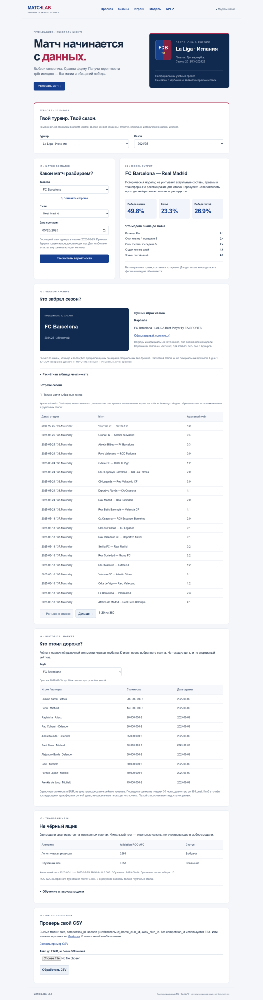

# MatchLab · Barcelona edition

Учебный ML-сервис для исторического моделирования матчей La Liga. Версия **0.7 / рабочий MVP**, а не завершённая производственная система. Футбольная адаптация лабораторной №10: вместо одобрения ипотеки — вероятности `home`, `draw`, `away`. Смена предметной области требует согласования с преподавателем.

## Что работает

- 4 940 матчей, 13 полных сезонов 2012/13–2024/25 из предоставленного архива; Barcelona — ID **131**, не Espanyol Barcelona.
- Признаки до начала дня матча: Elo, средние очки/голы за последние пять игр, отдых, количество предыдущих матчей.
- Две обученные модели, отдельная validation для выбора, отдельный финальный test.
- FastAPI: одиночный/пакетный прогноз, CSV, обучение, безопасная загрузка подписанного `.pkl`.
- Адаптивный HTML/CSS/JS-интерфейс без CDN: выбор команд, вероятности, признаки, метрики, CSV и админ-управление.
- 27 тестов; измеренное покрытие `app` + `ml` **92%**. Ruff, ESLint, проверки DOM-контракта.
- Многоэтапный Dockerfile, пользователь 10001, Compose, healthcheck, сохранение модели в томе.
- Конфигурации GitHub Actions и SourceCraft. Наличие YAML не означает подтверждённый успешный удалённый запуск.



## Границы версии «70%»

70% — согласованный ориентир объёма MVP, не формальная оценка выполнения всех неизвестных лабораторных. Реально сделанные и оставшиеся части перечислены ниже.

| Направление | В этой версии | Осталось |
|---|---|---|
| Данные и ML, лабораторная 10 | Предобработка, две модели, feature selection, ROC-AUC, сериализация | Калибровка, интервалы неопределённости, подбор гиперпараметров |
| FastAPI/Pydantic, лабораторная 6 | Валидация, ошибки, Swagger, middleware, разделение ML/API/UI | PostgreSQL, SQLAlchemy и Alembic для истории прогнозов — **пока не реализованы** |
| pytest, лабораторная по тестированию | Осмысленные unit/API/security-тесты, coverage >70% | Browser e2e-тесты, нагрузочные тесты |
| Docker/CI, лабораторная 7 | Dockerfile/Compose, lint/test/build workflow | Подтвердить удалённую сборку и публикацию образа нового проекта |
| Статический сайт, ранняя работа | README и воспроизводимый отчёт метрик | Отдельный MkDocs-сайт и деплой отчёта |
| SourceCraft, лабораторная 10 | `.sourcecraft/ci.yaml`: backend, frontend, сборка | Импорт репозитория и **реальный** запуск в аккаунте SourceCraft |
| Команда | Предложено разделение ответственности | Указать реальных участников; их работу не имитируем |

Аббревиатуры DAST/DATS в условии не расшифрованы. Соответствие конкретному неизвестному стандарту не заявляется; реализованы типизация, линтинг, разделение ответственности и проверки безопасности.

## Запуск на Windows через Docker Desktop

Не требует установки Python на Windows. Команды PowerShell выполняются в корне проекта. Используется **порт 8001**, чтобы не конфликтовать с прошлым FastAPI-проектом на 8000.

```powershell
("ADMIN_TOKEN=" + [guid]::NewGuid().ToString("N")) | Set-Content -Encoding ascii .env
docker compose up --build -d
docker compose exec app python -m ml.train
docker compose restart app
docker compose ps
```

Открыть **http://127.0.0.1:8001/**, Swagger — **http://127.0.0.1:8001/docs**.
Первая команда создаёт новый локальный токен. Не выполнять её повторно без необходимости: это заменит токен управления. `.env` не коммитится.

Обучение сохраняет pipeline в `models/champion.pkl`, подпись использует локальный `models/signing.key`; всё хранится в Docker-томе. При первом запуске без модели прогнозы отвечают 503. После обучения и перезапуска модель загружается автоматически. Для обучения через интерфейс раскрыть «Обучение и загрузка модели» и ввести ADMIN_TOKEN из своего `.env`.

```powershell
docker compose logs --tail 50 app
docker compose down
```

`down` не удаляет модель; **`down -v` удалит том модели и ключ подписи**.

## Локальный запуск Python

Python 3.12 рекомендован; локальная проверка выполнена в Linux/Python 3.13.15, а контейнер описан на Python 3.12. Полный lock всех транзитивных зависимостей — отдельная задача; прямые зависимости закреплены.

```powershell
py -m venv .venv
.\.venv\Scripts\python.exe -m pip install -r requirements-dev.txt
.\.venv\Scripts\python.exe -m ml.train
$env:ADMIN_TOKEN = [guid]::NewGuid().ToString("N")
.\.venv\Scripts\python.exe -m uvicorn app.main:app --port 8001
```

## Проверки

```powershell
.\.venv\Scripts\python.exe -m ruff check .
.\.venv\Scripts\python.exe -m ruff format --check .
.\.venv\Scripts\python.exe -m pytest --cov=app --cov=ml --cov-fail-under=70 -q
npm ci
npm run lint
npm test
```

Node.js 22+ необходим только для frontend-линтера и проверок. Для работы веб-интерфейса Node.js не нужен.

Реальные локальные протоколы: [pytest/coverage](docs/test-results.txt), [Ruff/ESLint](docs/lint-results.txt), [метрики](docs/metrics.json). Время запуска тестов зависит от среды. Тесты выполняют обучение в отдельном временном каталоге моделей, не удаляют пользовательскую модель. PostgreSQL не подменяется SQLite: в данной версии БД вообще ещё нет.

## API

| Метод | Путь | Назначение |
|---|---|---|
| POST | `/upload-model` | Загрузка подписанного `.pkl`, нужен `X-Admin-Token` |
| POST | `/predict` | `matches` (сырые команды/дата) **или** `features` (числовые признаки), 1–100 записей |
| POST | `/predict-from-csv` | До 500 строк / 2 MiB, сырые или предобработанные данные; исходные колонки + прогноз + вероятности |
| POST | `/train` | Обучение двух моделей на фиксированных данных; нужен токен |
| GET | `/metrics` | Честные метрики и границы обучения |
| GET | `/features` | Схема числовых входов и классы |
| GET | `/teams` | Список клубов, ID, конец исторического среза |
| GET | `/model` | Скачать подписанный файл; нужен токен |
| GET | `/health` | Работоспособность API и наличие модели |

Пример `/predict` в Swagger:

```json
{"matches": [{"home_club_id": 131, "away_club_id": 418, "date": "2025-05-26"}]}
```

Ожидается массив `predictions`: `predicted_result`, `probabilities` для трёх классов и рассчитанные признаки. В футболе `loan_status` заменён на `result` / `predicted_result`. Ровно один режим: `matches` либо `features`; набор готовых признаков должен содержать все 13 колонок до встроенного отбора. Дальше pipeline сам выбирает 10.

CSV: [сырой пример](data/example_raw.csv), [предобработанный пример](data/example_features.csv). Необязательная целевая колонка — `result` (`home/draw/away`). ROC-AUC рассчитывается **по вероятностям**, не по дискретным меткам. Без меток или без всех трёх классов возвращается `null` с объяснением. Оценка произвольного CSV не выдаётся за независимый тест; для дат периода обучения возвращается `in_training_period=true` в сыром режиме. Для готовых признаков без даты определить это невозможно.

Ошибки: 401 — неверный токен; 413 — превышен размер; 422 — невалидные данные/подпись/одинаковые команды; 503 — модель отсутствует или управление отключено.

## ML и защита от утечек

1. Исходная гранулярность — один завершённый матч. Фильтр ES1, сезоны 2012–2024; 380 матчей в каждом сезоне. Независимая проверка стандартным `csv`: [data-check.json](docs/data-check.json).
2. Даты явно преобразуются в даты. `aggregate`, распознанный профайлером как дата, исключён: это счёт, не временной признак. Идентификаторы не суммируются как показатели. Неполный сезон 2025/26 исключён **по заранее заданному окну**, не по исходам матчей.
3. Пропуски критических полей, дубли game_id, одинаковые команды и невозможные голы вызывают ошибку. Реальные крупные счета не удаляются как «выбросы»: удаление исказило бы исходы. Отдых ограничен 30 днями; новый клуб начинает с Elo 1500 и нейтральных значений формы. Для числового pipeline есть median imputer, обученный только на train.
4. Форма, Elo и число матчей рассчитываются **до дня игры**. Все игры одного дня сначала получают признаки, затем обновляют историю. Тесты проверяют, что изменение текущих/будущих счетов не меняет входы прошлого.
5. Голы текущего матча, итоговые места, attendance, формации и менеджеры не входят в X. Категориальные названия клубов не кодируются: они используются только для отображения; числовые ID служат ключами истории, не регрессорами. Категориальных входных признаков нет, поэтому OneHotEncoder не нужен.
6. Train: сезоны 2012–2020, **3 420** матчей; validation: 2021–2022, **760**; test: 2023–2024, **760**. Это последовательное разделение по времени вместо случайного train_test_split.
7. `SelectKBest(f_classif, k=10)`, imputer и scaler обучаются внутри pipeline без доступа к validation/test. Выбор алгоритма — только по validation ROC-AUC. После выбора pipeline переобучается на train+validation (4 180 матчей) и один раз оценивается на test.
8. Во время последовательной проверки формы тестовые признаки могут использовать **уже завершившиеся** предыдущие тестовые матчи: это rolling pre-match / walk-forward постановка, а не прогноз всего сезона из одной начальной точки.

### Измеренные метрики

| Алгоритм | Validation ROC-AUC macro OVR | Validation accuracy |
|---|---:|---:|
| Logistic regression | 0.6510 | 0.5237 |
| Random forest | 0.6517 | 0.5237 |

| Финальная проверка на 760 матчах | ROC-AUC macro OVR | Accuracy | Log loss |
|---|---:|---:|---:|
| Выбранная модель: random_forest | 0.6773 | 0.5342 | 0.9703 |
| DummyClassifier(prior) | 0.5000 | 0.4421 | 1.0737 |

Разница validation ROC-AUC небольшая; статистическая значимость превосходства RF не заявляется. Вероятности не калиброваны; ROC-AUC не доказывает их точность и не означает доходность ставок. Данные заканчиваются **2025-05-25**, модель обучена на матчах по **2023-06-04**. Более поздние сценарии — историческая симуляция, не анализ текущей Barcelona. Источник/лицензия исходного архива не были приложены; происхождение и хеш сохранены в manifest. Репозиторий создан **приватным**, пока права публикации исходных данных не уточнены.

## Безопасность моделей

Обычный `pickle.load` способен выполнять код. Произвольный `.pkl` из интернета **не принимается**. Артефакт проекта: magic header + HMAC-SHA256 + pickle pipeline. Подпись проверяется **до десериализации**; затем проверяется схема. Загружать можно только файл, подписанный тем же экземпляром проекта/ключом. Это осознанное ограничение учебной реализации, не совместимость с любым sklearn-pickle. Для переноса модели между экземплярами необходимо безопасно перенести signing key или установить одинаковый `MODEL_SIGNING_KEY` (32+ символа), не коммитить его. Ключ подписи и ADMIN_TOKEN — разные секреты.

Управление выключено, если ADMIN_TOKEN не задан. Токены не пишутся в логи и не сохраняются frontend. Ключи и обученные бинарные файлы не публикуются в Git. Для запуска вне localhost нужны HTTPS, лимиты ресурсов, rate limiting и более сильная аутентификация. `/train` предназначен для локального учебного стенда; не для тяжёлого обучения на публичном worker.

## CI и SourceCraft

`.sourcecraft/ci.yaml`: одна задача с последовательными cubes backend-lint-test → frontend-lint-test → build-container. Проверяются backend Ruff/pytest, frontend ESLint/DOM-контракт; Docker build запускается только после успешных проверок. Синтаксис `on/workflows/tasks/cubes` основан на [официальной документации](https://sourcecraft.dev/portal/docs/en/sourcecraft/operations/ci-cd).

**Статус SourceCraft: конфигурация подготовлена, в аккаунте SourceCraft не запускалась.** Нужны импорт репозитория и доступный Docker-capable runner. Скриншоты несуществующего успешного pipeline не приложены. GitHub Actions подготовлен аналогично; публикация в реестр и деплой не входят в эту версию. Локальная среда не имеет Docker daemon, поэтому локальную Docker-сборку нельзя считать проверенной.

## Предлагаемая работа команды

- ML Engineer: данные, признаки, validation/test, модель и качество.
- Backend Developer: FastAPI, загрузка, ошибки, безопасность; следующая итерация — PostgreSQL/Alembic.
- Frontend Developer: адаптивный интерфейс, UX ошибок, e2e.

Имена участников и фактическое распределение должны быть заполнены реальными участниками. AI не выдаётся за члена команды; [промпты и решения](docs/PROMPTS.md) сохранены.

## Структура

```text
app/        FastAPI, middleware, Pydantic
ml/         признаки, обучение, подписанные артефакты
web/        HTML/CSS/JS
scripts/    извлечение исходного архива, frontend-проверка
tests/      API, ML, отсутствие утечек, безопасность
data/       исторический срез, manifest, примеры CSV
docs/       измеренные метрики, проверки, скриншоты, промпты
models/     локальные бинарные артефакты; исключены из Git
```

MIT относится только к коду; чужие данные не перелицензируются.
